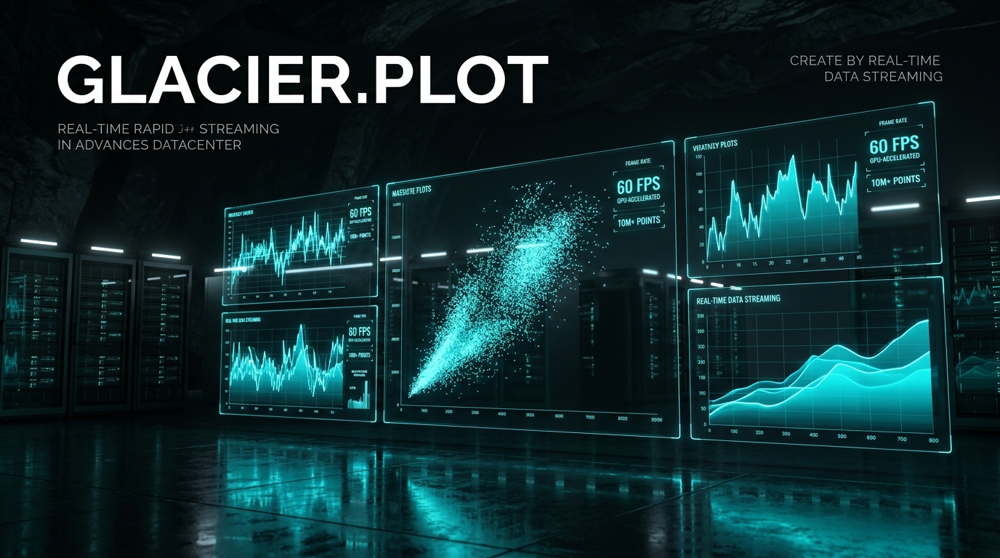
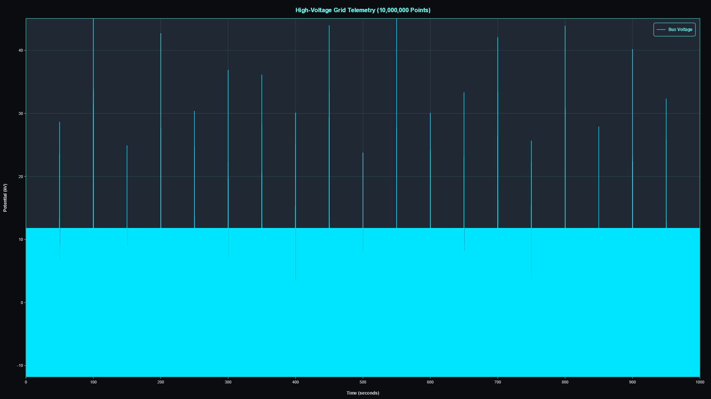
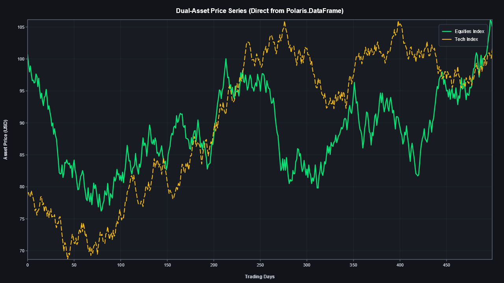
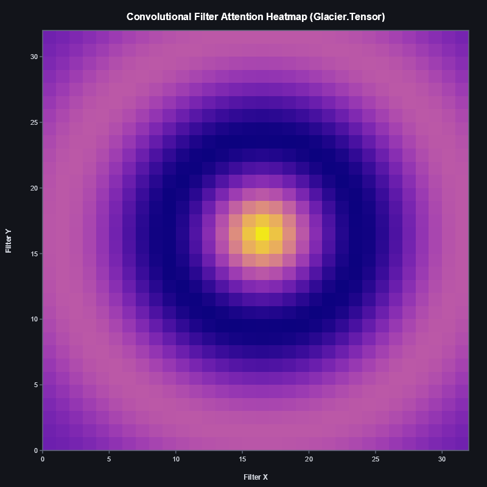
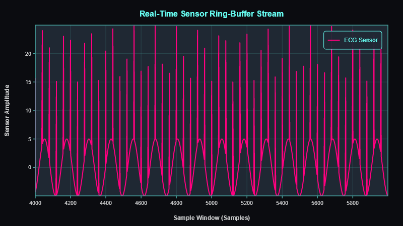

# Glacier.Plot

[](LICENSE)
[](https://dotnet.microsoft.com/)
[](https://learn.microsoft.com/dotnet/core/deploying/native-aot/)
[](https://www.nuget.org/packages/Glacier.Plot/)
[](https://glaciersoftware.dev/)

`Glacier.Plot` is a 2D scientific and statistical plotting library for .NET 10. It renders static PNG/SVG charts and live streaming series directly on top of `Glacier.Graphics`, reading unmanaged spans from `Glacier.Polaris` and `Glacier.Tensor` with SIMD and NVIDIA CUDA decimation.

It is built for telemetry dashboards, engineering tools, and notebooks that need fast downsampling of multi-million-point time series, statistical distribution plots, and clean vector/raster exports without native C++ plotting dependencies.

| 10M-Point Signal (LTTB Decimated) | Glacier.Polaris Multi-Series Chart |
| :---: | :---: |
|  |  |

| Glacier.Tensor 2D Heatmap | Lock-Free Streaming Trace |
| :---: | :---: |
|  |  |

## Install

```powershell
dotnet add package Glacier.Plot
```

## Quick Start

```csharp
using Glacier.Plot.Core;
using Glacier.Plot.Figures;
using Glacier.Plot.Interop;
using Glacier.Polaris;

var df = DataFrame.ReadParquet("telemetry_10m.parquet");

using var fig = new Figure
{
    Title = "Sensor Telemetry",
    Theme = PlotTheme.Dark
};
fig.XAxis.Label = "Timestamp (s)";
fig.YAxis.Label = "Voltage (V)";

fig.PlotLine(df.GetColumn("Timestamp"), df.GetColumn("Voltage"), label: "Sensor Voltage", color: Colors.Cyan);
fig.SavePng("output_4k.png", width: 3840, height: 2160);
fig.SaveSvg("output_vector.svg", width: 1920, height: 1080);
```

## What You Can Do

- **Plot dense time series & heatmaps (`Figure`):** Add `SignalPlot`, `ScatterPlot`, `BarPlot`, `HistogramPlot`, `HeatmapPlot`, and lock-free `StreamingLinePlot` series with `PlotTheme` styling and `Legend` layout.
- **Downsample millions of points (`LttbKernels`, `MinMaxKernels`, `GpuPlotAccelerator`):** Run uniform/strided LTTB and Min-Max decimation across AVX-512 / AVX2 CPU lanes or offload `MinMaxDownsample`, coordinate transforms, and bucket averages to NVIDIA CUDA via `GpuTarget.Auto`.
- **Build grammar-of-graphics statistical charts (`Chart`):** Construct `Chart.FromDataFrame(df)` pipelines with `Encode`, `FacetGrid`, `GeomViolin`, box/boxen plots, 1D/2D KDE (`GpuStatsAccelerator`), regression plots, and correlation summaries.
- **Consume Polaris & Tensor data directly (`PolarisPlotExtensions`, `TensorPlotExtensions`):** Plot `ISeries`, `DataFrame` columns, and `Tensor<float>` buffers without copying data, and export via `GlacierGraphicsPlotExtensions` or `SvgGraphicsCanvas`.

## Platform & Compatibility

`Glacier.Plot` targets `.NET 10` (`net10.0`) with `<IsAotCompatible>true</IsAotCompatible>`. GPU acceleration uses the NVIDIA CUDA driver API (`CudaPlotContext`) and falls back to multi-core AVX-512 / AVX2 SIMD kernels via `GpuTarget.Auto` or `GpuTarget.Cpu` (`GpuTarget.Amd` throws `PlatformNotSupportedException`).

## Benchmarks

Measured on this workstation (`.NET 10.0.15` Release x64, `AMD Ryzen AI 9 HX 370`, `NVIDIA GeForce RTX 4060 Laptop GPU`):

| Benchmark | Workload | Latency | Throughput | Backend |
| :--- | :--- | ---: | ---: | :--- |
| `LttbKernels.DownsampleUniform` | 100,000 pts -> 1,920 px | 0.102 ms | 982.7 M pts/s | CPU SIMD |
| `LttbKernels.DownsampleUniform` | 1,000,000 pts -> 1,920 px | 0.383 ms | 2,611.5 M pts/s | CPU SIMD |
| `LttbKernels.DownsampleUniform` | 10,000,000 pts -> 1,920 px | 2.558 ms | 3,909.8 M pts/s | CPU SIMD |
| `MinMaxKernels.DownsampleUniform` | 10,000,000 pts -> 1,920 px | 1.756 ms | 5,693.5 M pts/s | CPU SIMD |
| `GpuPlotAccelerator.MinMaxDownsample` | 1,000,000 pts -> 2,000 px | 0.796 ms | 1,255.5 M pts/s | RTX 4060 CUDA |

See [docs/benchmarks.md](docs/benchmarks.md) for commands and environment details.

## Documentation

- [User Manual](docs/manual.md) — `Figure`, plottables, decimation kernels, CUDA offload, statistical grammar `Chart`, and interop APIs
- [Architecture](docs/architecture.md) — Span-based pipeline, shared `CudaPlotContext`, SIMD kernels, and lock-free `StreamingLinePlot`
- [Benchmarks](docs/benchmarks.md) — Reproducible CPU SIMD and GPU decimation numbers
- [Changelog](CHANGELOG.md) — Release history (`v1.2.1` – `v1.2.2`)

## License & Credits

Licensed under the [MIT License](LICENSE).

Developed by Ian Cowley, Antigravity (Google DeepMind) and Claude.
