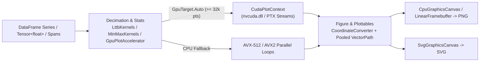

# Glacier.Plot Architecture

`Glacier.Plot` reads contiguous spans from `DataFrame` columns, `Tensor<float>` buffers, or raw `float[]` slices, downsamples oversized series to pixel-width resolution on GPU or CPU SIMD, and draws batched `VectorPath` geometry onto `Glacier.Graphics` raster/SVG targets.

## 1. Rendering & Compute Pipeline

## 2. Key Design Invariants

- **Shared CUDA Context & Stream Pool (`CudaPlotContext`):** `GpuPlotAccelerator` and `GpuStatsAccelerator` share one VRAM-capped CUDA context, compiled PTX modules normalized through `KernelCompiler.NormalizePtxDirectives`, and deterministic `ProcessExit` / `ReleaseGpuResources()` teardown. `GpuTarget.Amd` throws `PlatformNotSupportedException` because embedded PTX kernels target NVIDIA devices while AMD/Intel hosts run CPU SIMD.
- **In-Register SIMD Decimation:** `MinMaxKernels` and `LttbKernels` find bucket extrema in vector registers without extra linear `IndexOf` scans, keeping decimation allocations at zero bytes during redraws.
- **Lock-Free SPSC Streaming (`StreamingLinePlot`):** Uses a 128-byte cacheline-padded `PaddedCursor` with sequence-stamped writes so telemetry producers append samples without blocking UI render frames.
- **Pooled Geometry (`VectorPath`):** `Figure` reuses `_dataRectPath`, `_gridPath`, `_tickPath`, and `_yAxisLabelPath` across renders, batching gridlines and rotated Y-axis glyph paths cleanly.
